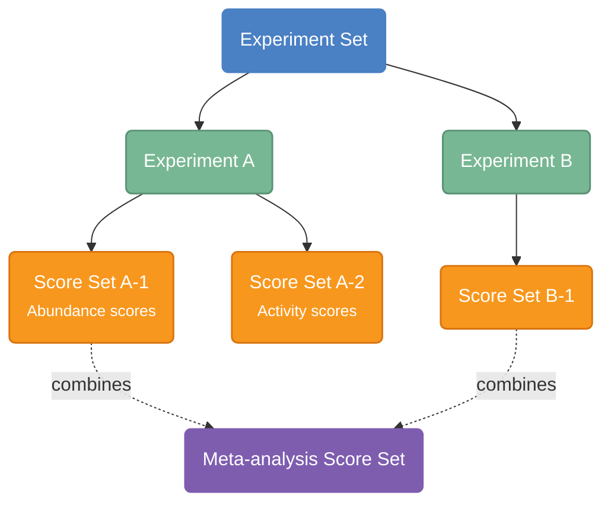

# Key Concepts

This page defines the records and terms used throughout MaveDB. To submit data, see [Submitting Data](../submitting-data/index.md).

## Data model overview

MaveDB organizes data in a three-level hierarchy: **experiment sets** contain **experiments**, which contain **score sets**. MaveDB also supports **meta-analysis score sets**, which are linked to existing score sets rather than to an experiment.

The diagram below shows a real-world example of this structure using data from a *BRCA1* study:

<figure markdown="span">
  
  <figcaption>Data model for <a href="https://www.mavedb.org/#/experiment-sets/urn:mavedb:00000003/">urn:mavedb:00000003</a>, a BRCA1 experiment set with two functional assays and four score sets.</figcaption>
</figure>

This experiment set describes two distinct assays performed on a single *BRCA1* variant library, each with two associated score sets. For how to split your own study this way, see [Organizing Your Study](../submitting-data/organizing-your-study.md).

## Experiment sets

An experiment set groups the experiments performed on one target. It has no data or metadata of its own and is created automatically with its first experiment.

## Experiments

An experiment describes a MAVE performed on a target, up to and including sequencing: library construction, the assay, and the sequencing strategy ([example](https://www.mavedb.org/#/experiments/urn:mavedb:00000003-a/)). Experiments also record publications, raw data accessions, and [controlled keywords](../reference/controlled-vocabulary.md).

## Score sets

A score set holds the variant effect scores calculated from an experiment's data, and describes how they were calculated ([example](https://www.mavedb.org/#/score-sets/urn:mavedb:00000003-a-1/)). Score sets are the main way people use MaveDB data. A score set contains:

- **Variant effect scores**, one per variant, plus any other numeric columns the submitter includes, such as standard errors or replicate scores.
- **Count data** (optional), the variant counts from sequencing.
- **One or more [targets](#targets)**, the sequences the variants are described against.
- **Methods** describing how scores were calculated.

!!! tip "Counting datasets"
    When MaveDB reports the number of **datasets**, it counts score sets. An experiment that produced both abundance and activity scores contributes two datasets.

## Meta-analysis score sets

A meta-analysis score set is linked to one or more existing score sets instead of an experiment. It holds analyses of existing scores, such as combined, imputed, or normalized scores. For example, [urn:mavedb:00000055-0-1](https://www.mavedb.org/#/score-sets/urn:mavedb:00000055-0-1/) combines two *NUDT15* assays into a single composite function score.

## Targets

All variants in a MaveDB score set are described relative to a **target** -- the sequence that was mutagenized to create the variant library. MaveDB supports two types of targets:

- **Sequence-based targets**: Based on the full sequence that was mutagenized. Use this when the variant library was built from a mutagenized construct (e.g., a cDNA library in a deep mutational scan), even if that sequence matches a known reference exactly.
- **Accession-based targets**: Based on a RefSeq or Ensembl accession for a genomic locus. Use this when variants were edited directly into the genome at their native locus (e.g., saturation genome editing or base editing).

The choice records how the variants were introduced, not only which sequence they are described against. See [why this matters](../submitting-data/targets.md#why-we-recommend-a-sequence-based-target-for-constructs).

Each score set must be associated with at least one target. Some experiments (such as protein-protein interaction assays) may associate multiple targets with a single score set.

!!! info "See also"
    For detailed information about target types and metadata, see the [Targets](../submitting-data/targets.md) page.

## Contributors

Record owners can add other users as **contributors**. Contributors can view, edit, and upload data to a record, but only the owner can publish or delete it.

!!! info "See also"
    For details on adding contributors, permissions, and cross-record behavior, see the [Contributors](../submitting-data/metadata-guide.md#contributors) section of the Metadata Guide.

## Accession numbers

Every record in MaveDB is assigned a unique accession number (URN). Published records have accession numbers in the format `urn:mavedb:NNNNNNNNN`, where the number hierarchy reflects the data model:

| Record type      | Format example              | Description                          |
|------------------|-----------------------------|--------------------------------------|
| Experiment set   | `urn:mavedb:00000003`       | Top-level identifier                 |
| Experiment       | `urn:mavedb:00000003-a`     | Suffix letter under the experiment set |
| Score set        | `urn:mavedb:00000003-a-1`   | Suffix number under the experiment   |

Records that have not yet been published are assigned temporary accession numbers beginning with `tmp:` instead of `urn:mavedb:`. These temporary records are only visible to the owner and contributors. See [Publishing](../submitting-data/publishing.md) for details on making records public.

!!! info "See also"
    For detailed information about accession number formats, see the [Accession Numbers](../reference/accession-numbers.md) reference page.

## Variant representation

Variants in MaveDB score sets are described using [MAVE-HGVS](../submitting-data/data-formats.md#variant-columns), an adaptation of the HGVS Sequence Variant Nomenclature designed for MAVE data. While standard HGVS packages rely on sequence database entries that may not be available for all MAVE target sequences, MAVE-HGVS validates variants against the target sequence provided with the score set, supporting both DNA and protein variant descriptions including substitutions, small insertions and deletions, and multi-mutants.

For score sets with [accession-based targets](#targets) (such as those from saturation genome editing experiments), variants can be defined with respect to a transcript accession or human genome reference, with validation handled by a local sequence database.

After upload, human-targeting score sets are automatically processed through [variant mapping](../mapping/forward-mapping.md), which translates variants to standard genomic coordinates and [GA4GH VRS](https://vrs.ga4gh.org/) format for interoperability with clinical and research databases.

## Data licensing

MaveDB supports [Creative Commons](https://creativecommons.org/) licenses for score sets. The recommended license is **CC0** (public domain dedication), which maximizes data reuse and enables inclusion in [bulk downloads](../finding-data/downloading.md#bulk-downloads-via-zenodo) and integration with downstream resources. Nearly all datasets in MaveDB have been licensed at the CC0 level.

## See also

- [Searching datasets](../finding-data/searching.md) -- find score sets by gene, organism, or publication.
- [Visualizations](../finding-data/visualizations.md) -- explore variant effect data through histograms, heatmaps, and 3D structure views.
- [Score calibrations](../reference/score-calibrations.md) -- learn how functional scores are calibrated for clinical interpretation.
- [Controlled vocabulary](../reference/controlled-vocabulary.md) -- definitions of terms used in MaveDB metadata.
- [Variant mapping](../mapping/forward-mapping.md) -- how MAVE variants are mapped to genomic coordinates.
